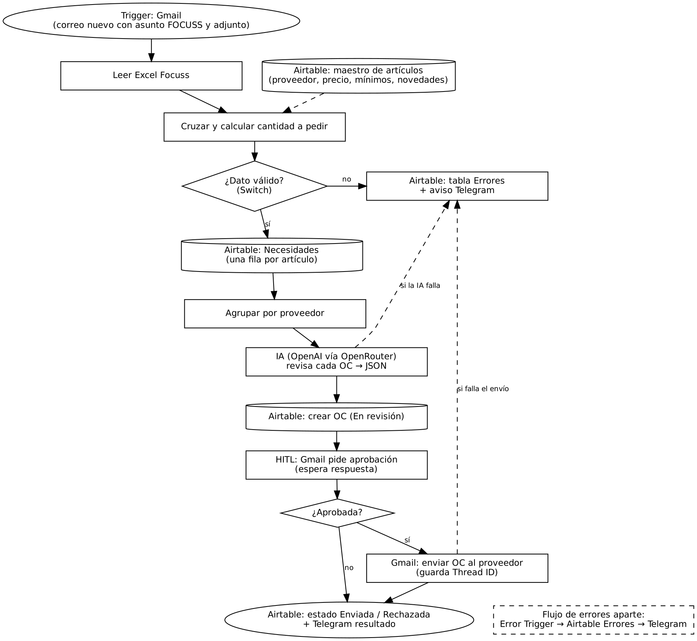

# Entrega Final – Órdenes de compra automáticas desde el reporte Focuss

Proyecto final del curso **Ecosistema de Automatización IA** (Coderhouse).

Un flujo en **n8n** recibe por correo el reporte diario de Focuss (artículos que requieren compra, con semáforo negro / rojo / amarillo). Lo cruza con el maestro de artículos en **Airtable** y calcula cuánto pedir a cada proveedor. Después, la **IA (modelos gratuitos vía OpenRouter)** revisa cada orden de compra contra alertas y novedades escritas por otras áreas. Ninguna OC sale al proveedor sin **aprobación humana** por **Gmail**, y los resultados se notifican por **Telegram**.

## Arquitectura

| Categoría | Herramienta |
| --- | --- |
| Orquestador | n8n (flujo principal + flujo de errores) |
| Base de datos / memoria | Airtable: 6 tablas vinculadas |
| Procesamiento IA | Router de modelos gratuitos `openrouter/free` vía OpenRouter (nodo OpenAI de n8n en modo JSON), prompt estructurado |
| Canales de salida | Gmail (aprobación HITL y envío al proveedor) y Telegram (alertas) |

## Contenido del repositorio

| Archivo | Qué es |
| --- | --- |
| `Entrega_Final_Documentacion.pdf` | Documento con los 5 criterios: arquitectura, estructuras de datos, costos, seguridad y resiliencia, dashboard |
| `Diagrama_Arquitectura.pdf` / `.png` | Mapa de arquitectura |
| `Flujo_Entrega_Final_OC_Focuss.json` | Flujo principal de n8n (los IDs de Airtable y el Chat ID están reemplazados por marcadores) |
| `Flujo_Errores_OC_Focuss.json` | Flujo de errores: avisa por Telegram y registra en Airtable si el flujo principal se cae |
| `datos/` | Base de Airtable de ejemplo y los 5 reportes Focuss simulados |
| `capturas/` | Evidencias de las ejecuciones |

## Enlaces

- Base de datos Airtable (solo lectura): https://airtable.com/appeVxftYSK1dP9mN/shrXfDdfMG0dRgDmN
- Dashboard OC – vista compartida agrupada por estado: https://airtable.com/appeVxftYSK1dP9mN/shrgSEiZcZ0yWIO8U
- Dashboard Errores – vista compartida agrupada por tipo: https://airtable.com/appeVxftYSK1dP9mN/shrrbbOxrb7Cqnocl
- Capturas de evidencia: carpeta `capturas/`
- Video demo (3 min):https://youtu.be/B2VuwMSNQBc

## Cómo ejecutarlo

1. Importa `datos/Base_Airtable_Compras_Focuss.xlsx` en Airtable y crea los vínculos y campos calculados descritos en la documentación.
2. En n8n, crea las credenciales de Airtable, OpenAI (Base URL `https://openrouter.ai/api/v1`), Gmail y Telegram.
3. Reemplaza los marcadores `APP_ID_BASE`, `TBL_*` y `PEGAR_AQUI_CHAT_ID` del JSON e impórtalo.
4. Envía un correo con asunto `FOCUSS` y uno de los Excel de `datos/` como adjunto.

> Todos los datos son simulados (proveedores ficticios). No hay credenciales en este repositorio.
